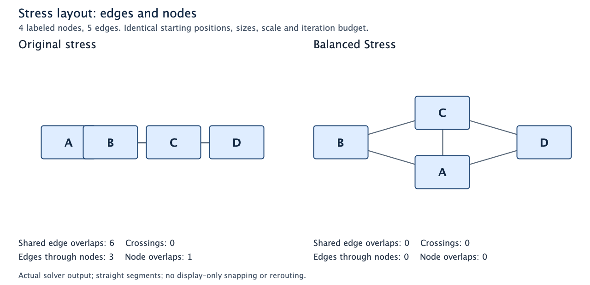

# Continuous stress layout

`graph.vijual/layout-stress-nodes` accepts arbitrary node data through adapters.
Positions are **rectangle centers**. Sizes, positions, gap and edge length use the
same units. Circumscribed node radii set minimum *target* distances; these are soft
stress constraints, not guaranteed collision-free packing.

```clojure
(require '[graph.vijual :as v])

(def input
  [{:id :a :position [0 0] :size [120 60] :label "A"}
   {:id :b :position [200 0] :size [80 40] :label "B"}])

(v/layout-stress-nodes input [[:a :b]] {:gap 20 :iterations 100})
```

The defaults are `:edge-length 80`, `:gap 10`, `:iterations 100`, `:tolerance 0`,
`:disconnected-weight 0.02` and `:pinned-ids #{}`. Zero disconnected weight disables
forces between disconnected nodes. Self edges and repeated/reversed edges do not
change the undirected stress objective. No grid snapping or routing is applied.

For custom structs, supply `:id-fn`, `:position-fn`, `:size-fn`, and
`:with-position` (called with the node and new center). Adapters must be pure;
`with-position` must preserve id/size and write the requested center. Other data
and record types are preserved. IDs need not be comparable.

## Balanced Stress

The default continuous method has no explicit symmetry or axis preference. The
older grid-refinement method includes an edge-length variance penalty, but does
not provide this continuous objective.

```clojure
(v/layout-balanced-stress-nodes input [[:a :b]]
  {:iterations 250 :edge-symmetry-weight 6 :edge-axis-weight 12
   :edge-overlap-weight 24 :edge-clearance 8 :mirror-symmetry-weight 24})

;; The same persistent update/advance operations work on this session.
(def balanced (v/create-balanced-stress-layout input [[:a :b]]))
(v/advance-stress-layout balanced {:iterations 20})
```

**Balanced Stress** combines equal edge lengths, inferred twin-node mirror
symmetry, axis alignment and geometric clearance. It preserves the original
size-aware all-pairs stress rule and adds
soft preferences over actual, deduplicated edges and node clearances:

* `:edge-symmetry-weight` (default **6**) penalizes squared deviations from one
  common edge length. That target is the greater of `:edge-length` and the largest
  edge clearance (the two node radii plus `:gap`). Node dimensions are unchanged.
* `:mirror-symmetry-weight` (default **24**) penalizes the squared distance from
  a twin node to its partner reflected across their shared anchors. Twins must
  have equal sizes and belong to an exactly two-member class with identical open
  or closed neighborhoods and at least two common neighbors. The mirror axis
  passes through the anchor centroid along their principal direction; coincident
  anchors use a horizontal axis. This conservative inference avoids arbitrary
  pairing in larger classes and does not search for general graph automorphisms.
* `:edge-axis-weight` (default **12**) penalizes `min(dx², dy²)`, preferring the
  nearest horizontal or vertical direction. Horizontal wins exact ties.
* `:edge-overlap-weight` (default **24**) penalizes shared edge segments,
  unrelated crossings, edges near unrelated nodes, and node-node clearance
  violations. `:edge-clearance` (default **8**, in layout units) is the desired
  buffer between edges and around unrelated nodes. Node-node clearance uses the
  two circumscribed radii plus `:gap`. Actual box intersections are counted
  separately from conservative radial clearance violations.

Each iteration majorizes the length/axis terms at the current coordinates, combines
their weighted targets with the existing targets, and uses the same damped update.
When geometric conflicts or inferred mirror pairs are present, an objective guard
backtracks a proposed
step up to eight times. It also tests bounded endpoint/whole-edge displacement
proposals at four scales to escape collinear or crossing traps. A correction is
accepted only if the full combined objective decreases; pins are never moved.
Mirror proposals move both twins together: projection toward reflection symmetry
and eight bounded placements on opposite sides of the anchor axis. If one twin
is pinned, only its free partner is proposed; fully pinned pairs stay fixed.
These moves can escape a collinear local minimum without modifying the input seed.
The combined objective can improve while the original graph-distance stress
increases. Preferences remain local, soft constraints: they do not guarantee a
global optimum, infer every graph symmetry, remove edge bends from an external
router, or guarantee non-overlap. Triangles require tilted edges in a clear
straight-line drawing, so axis alignment competes with equal lengths and balance. Incompatible topologies and pins can prevent alignment.

`:stress-method :balanced` also selects this method through the ordinary API;
`:standard` remains the default. The initial `layout-symmetric-stress-nodes` and
`create-symmetric-stress-layout` function names remain compatibility aliases, and
`:stress-method :symmetric` remains accepted. All four weights set to zero reproduce ordinary
stress exactly. Custom adapters, pins, immutable snapshots and BFS caches retain
their contracts. Length/axis contributions are refreshed per iteration in O(E)
work; `:preference-edge-evaluations` records that work separately from the cached
all-pairs contributions. Resizing recomputes the common target before relaxation.
Twin preparation uses hashed neighborhood signatures, followed by deterministic
sorting of the inferred pairs and anchors. It is refreshed on advance, including
after topology or size edits.
Clearance checking adds O(V² + VE + E²) work. Conflicts and mirror pairs trigger
full-objective trial evaluations, bounded per pair, so many mirror pairs add cost.
Disable clearance and mirror work with `:edge-overlap-weight 0` and
`:mirror-symmetry-weight 0` to retain the earlier equal-length/axis-only method. Ordinary stress skips this work entirely.

Geometric diagnostics include `:edge-overlaps` (positive-length shared runs),
`:edge-crossings` (proper intersections of unrelated edges), `:edge-node-overlaps`
(actual unrelated box interiors hit by an edge), `:node-overlaps` (actual box
intersections), and `:node-edge-conflicts` (the wider radial clearance margin).
These counts are meaningful when `:conflict-checks` is positive. Correction work
is reported in `:overlap-corrections`, `:overlap-backtracks`, and
`:conflict-energy-evaluations`. Fully pinned layouts retain and report conflicts. `:symmetry-proposals` counts
mirror candidates tested and `:symmetry-corrections` counts iterations accepting
one. Comparison JSON also reports `:mirror-pairs` and `:mirror-error` (the square
root of summed squared reflection errors, in layout units).

For example, four collinear nodes with five diamond edges produced 6 shared edge
overlaps, 3 edges through unrelated nodes and 1 overlapping node pair with ordinary
stress. Mirror symmetry plus clearance produced zero of all three, no crossings,
and no remaining radial clearance violations. Both inferred pairs have reflection
error below 1e-7. The resulting diamond is mirror-symmetric, though its aspect
ratio still reflects the soft axis-alignment preference; this is not a claim of
global optimality. Set `:mirror-symmetry-weight 0` to reproduce the earlier local
clearance method, which stopped in an asymmetric arrangement.



Generate the PNG directly from solver output without a browser:

```sh
clojure -J-Djava.awt.headless=true -M -m graph.vijual.stress-snapshot graph/vijual/examples/edge-clearance-comparison.png
clojure -M -m graph.vijual.stress-comparison comparison.json overlap
```

Node boxes are opaque and IDs are painted last, so labels remain visible even in
the bad baseline. The renderer clips straight edges at their endpoint boxes; it
does not snap, bend, reroute or otherwise repair the solver's geometry.

Reproduce the comparison on identical input coordinates, node sizes and budgets:

```sh
clojure -M -m graph.vijual.stress-comparison comparison.json
```

The perturbed nine-node grid, after 250 iterations, gives:

| Measure | Ordinary stress | Equal lengths + axes |
|---|---:|---:|
| Edge length variation (standard deviation / mean) | 1.072% | 0.083% |
| Mean angle to nearest horizontal/vertical axis | 22.732° | 0.067° |
| Original graph stress | 9,030.8 | 11,525.4 |
| Combined objective, evaluated with the same preference weights | 296,562.6 | 12,466.6 |

The JSON contains the input, edges, shared options, actual solver outputs, and
both metric sets. No display-only snapping or rotation is applied.

## Retaining work across edits

```clojure
(def prepared (v/create-stress-layout input [[:a :b]] {:gap 20}))
(def settled (v/advance-stress-layout prepared {:iterations 20}))

;; Upsert a complete node from the current output, with a new seed position.
;; Pinning holds that center fixed while other nodes can relax around it.
(def edited
  (v/update-stress-layout settled
    {:upsert-nodes [(assoc (first (:nodes settled)) :position [25 30])]
     :pin-ids #{:a}}))
(def next-layout (v/advance-stress-layout edited {:iterations 10}))

(:nodes next-layout)
(:deltas next-layout)
(:metrics next-layout)
```

Creation prepares distances and constants without relaxation. Updating applies an
atomic transaction without relaxation. Advancing performs up to the requested
number of synchronous damped iterations, stopping when maximum displacement is
at most `:tolerance`. Zero tolerance stops only at an exact fixed point.

Sessions are persistent snapshots. Advancing or editing a session leaves earlier
sessions usable, including cached sums and coordinates. Treat all fields except
`:nodes`, `:deltas`, `:revision` and `:metrics` as opaque; do not mutate internal
arrays. Session options are fixed at creation; create a new session to change the
objective or adapters. Output order retains surviving nodes and appends new nodes
in upsert order.

Transactions support:

| Key | Meaning |
|---|---|
| `:upsert-nodes` | Ordered sequence of complete replacements/additions, including positions and sizes |
| `:remove-node-ids` | Existing IDs to remove; incident edges and pins are also removed |
| `:add-edges` | Endpoint pairs; both endpoints must exist after the transaction |
| `:remove-edges` | Endpoint pairs naming existing input nodes; absent edges are harmless |
| `:pin-ids` | Fix existing nodes at their current or upserted centers |
| `:unpin-ids` | Allow existing nodes to move again |

Unknown keys, invalid geometry, missing endpoints, duplicate upsert IDs, or
conflicting operations throw `ExceptionInfo` without changing the input session.
Upserts honor their supplied positions; use the latest output nodes to avoid
accidentally restoring stale positions during a metadata edit.

## Invalidation and observability

Metadata, position, size and pin edits reuse all graph distances and pair constants.
Metadata-only edits reuse the numerical cache too. Geometry edits mark sums stale
relative to their recorded coordinate/size basis. Relaxation subtracts old and
adds new incident-pair contributions when two sparse evaluations cost less than a
full sweep; otherwise it rebuilds sums with the packed numeric kernel.

Topology edits recompute BFS rows in the union of affected old/new undirected
components. Other source rows are shared. Pair constants are repacked and force
sums invalidated. The global diameter is recomputed because it sets disconnected
target distances. An edit within one connected graph can require all-source BFS.

Metrics are per operation: `:iterations`, `:pair-evaluations`, `:dense-sweeps`,
`:sparse-sweeps`, `:distance-sources-recomputed`, `:changed-positions` and
`:max-displacement` (last iteration). Pair evaluations count visited pairs,
including both old and new visits during sparse updates. Creation counts initial
positions as changes; removals are represented by deltas. A no-op edit performs
no solver work. Exact all-pairs relaxation can still affect every node and remains
quadratic in node count; this API does not promise a frame-time budget.

`:deltas` contains `[node -1]` retractions followed by `[node 1]` insertions.
Replacements emit both rows; unchanged nodes emit none. Rows follow input/output
node order without sorting or requiring comparable node data.

## Dataflow adapter

```clojure
(require '[clojure.core.async :as a])
(def commands (a/chan 8))
(def results ((v/stress-layout-flow settled) commands))
(a/>!! commands {:changes {:pin-ids #{:a}} :iterations 10})
(a/<!! results) ; {:revision ... :nodes ... :deltas ... :metrics ...}
(a/close! commands)
```

This adapter uses the existing `differential-dataflow.stream-ops/scan-emit` state
machine and channel backpressure. It emits one result per command and closes its
output when input closes. There is no unsolicited initial output. Iterations
default to **zero** in stream commands; advancing work is explicit. An edit and
its requested relaxation publish one combined delta and one revision. Invalid
commands emit `:error` and retain the last valid state. The numerical work runs
synchronously inside the stream transition; choose bounded iteration budgets.

The general graph join also consolidates only touched keys, retaining the same
signed-delta semantics. Numerical sweeps do not materialize all pair contributions
as channel joins or whole-bag reducers.

## Reproducing the benchmark

```sh
clojure -J-Xmx1g -M -m graph.vijual.stress-bench 100 250 500 1000
```

The harness warms both implementations, reports median/min/max over three samples,
and compares coordinates and stress energy with the original map-based formula.
It separates complete batches, preparation, prepared relaxation, geometry edits,
connected/component topology edits, isolated additions, and sparse pinned updates.
Allocation is cumulative calling-thread allocation, not live heap. The default
budget is 10 iterations; the one-shot layout default remains 100 iterations.

One local run on Java 25.0.2 / Clojure 1.12.4, with a 1 GB heap, produced these
medians in milliseconds (three samples after six warmup calls per implementation):

| Nodes | Reference complete call | Optimized complete call | Prepared relaxation | Position edit only | Sparse pinned step |
|---:|---:|---:|---:|---:|---:|
| 100 | 54.6 | 29.0 | 14.3 | 0.57 | 0.92 |
| 250 | 623.8 | 173.3 | 85.7 | 0.75 | 1.17 |
| 500 | 1,762.2 | 774.8 | 377.0 | 6.31 | 12.01 |
| 1,000 | 7,386.7 | 2,925.9 | 1,469.9 | 9.78 | 8.59 |

Complete calls and prepared relaxation use 10 iterations. Position edits run no
relaxation; the sparse workload moves one free node among pinned path nodes for
one iteration. These columns represent different operations, not interchangeable
speedups. At 1,000 nodes the sparse step visited 1,998 pairs versus 499,500 for a
full sweep. A component edge edit recomputed 25 BFS rows; an isolated addition
recomputed one. Both still repack the pair constants.

Coordinates and stress energy matched the reference exactly for every measured
size, both before and after the position edit. Calling-thread allocation for the
1,000-node complete call fell from 20,591 MB to 1,694 MB; prepared relaxation
allocated 4.17 MB. These are cumulative allocations, not retained memory. Timing
is exploratory and sensitive to GC; the harness also prints sample ranges.
